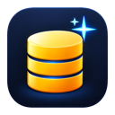

<p align="center"></p>

# Lumino DB

**Lumino** is a fast, native, open-source database IDE — an alternative to DBeaver and Beekeeper
Studio, written in Go with a GPU-rendered [Gio](https://gioui.org) UI. No Electron, no JVM: one small
binary for Linux, Windows and macOS.

[](https://github.com/twoojoo/lumino/actions/workflows/ci.yml)
[](https://github.com/twoojoo/lumino/releases/latest)
[](LICENSE)

## Databases

PostgreSQL, CockroachDB, MySQL, MariaDB, TiDB, SQLite, SQL Server, Oracle, ClickHouse, Firebird,
Cassandra / ScyllaDB and Trino — all with pure-Go drivers, all covered by the same conformance suite.

## Features

- **Connections**: saved connections with passwords in the OS keyring, SSH tunnels (password, key,
  agent; known-hosts verification), TLS (require / verify CA / verify full, client certificates),
  connection URLs, init SQL, colors, production and read-only policies.
- **Navigator**: lazy tree of catalogs, schemas, tables, views, routines and sequences, with filter,
  columns, context actions (open, DDL, generate SQL, truncate, drop).
- **SQL console**: editor with syntax highlighting per dialect, context-aware completion (tables,
  aliases, columns, keywords), find/replace, multi-statement scripts (dollar quotes, `DELIMITER`, `GO`,
  PL/SQL `/`, `SET TERM`), run statement at caret or selection, cancel, error positions, auto-commit or
  manual transactions, query history and saved queries.
- **Results**: virtualized grid streaming rows from an open cursor (fetch on scroll), multiple result
  sets, client-side sort, cell selection and copy as TSV/CSV/JSON/SQL/Markdown, value viewer (text,
  JSON, hex), export to file.
- **Table view**: server-side `WHERE` and `ORDER BY`, inline editing with insert/update/delete, review
  of the generated SQL, transactional save, structure (columns, indexes, keys, constraints, triggers)
  and DDL.
- **Assistant**: Anthropic or any OpenAI-compatible provider (Ollama included); reads the schema,
  samples rows with sensitive columns redacted, runs read-only queries, proposes SQL you insert yourself.
- Ayu themes (dark, mirage, light), desktop notifications for long queries, signed self-updates.

## Install

Download the latest package from
[Releases](https://github.com/twoojoo/lumino/releases/latest):

| OS | Package |
|---|---|
| Linux (x86_64) | `.AppImage` (portable), `.deb`, `.rpm`, `.tar.gz` |
| Windows 10+ (x64, ARM64) | portable `.zip` |
| macOS 12+ (Apple silicon and Intel) | `.dmg` or `.zip` |

Lumino updates itself (Preferences → Updates) and installs only releases whose checksums are signed
with the Lumino release key; `.deb`/`.rpm` installs are updated through the package manager.
Third-party licenses: `THIRD_PARTY_NOTICES.txt` in every package and release.

### Verifying a download

`SHA256SUMS.txt` lists the checksum of every file and is signed with the Lumino release key
(ed25519, `SHA256SUMS.txt.sig`, base64). Public key:

```
CK1TEM6TZg/WTFIoj/e46uM9J5TtSx7RFQ5P6fUXFGE=
```

The self-updater refuses any file that doesn't match a checksum signed with this key. To check by
hand: `sha256sum -c SHA256SUMS.txt --ignore-missing`, then verify the signature with any ed25519
tool, e.g. in Python with `cryptography`:

```python
import base64
from cryptography.hazmat.primitives.asymmetric.ed25519 import Ed25519PublicKey
key = Ed25519PublicKey.from_public_bytes(base64.b64decode("CK1TEM6TZg/WTFIoj/e46uM9J5TtSx7RFQ5P6fUXFGE="))
key.verify(base64.b64decode(open("SHA256SUMS.txt.sig").read()), open("SHA256SUMS.txt", "rb").read())
print("signature ok")
```

### Building from source

To build from source you need Go (version in `go.mod`) and, on Linux, the Wayland/X11/EGL development
headers listed in [`.github/workflows/ci.yml`](.github/workflows/ci.yml) (`GIO_LINUX_DEPS`):

```sh
make build      # ./lumino
```

## How it compares

| | Lumino | DBeaver CE | Beekeeper Studio CE | TablePlus | DataGrip |
|---|---|---|---|---|---|
| Runtime | native (Go, GPU UI) | JVM (Eclipse) | Electron | native | JVM |
| License | GPL-3.0 | Apache-2.0 | GPL-3.0 | proprietary | proprietary |
| Price | free | free | free | paid | paid |

## FAQ

**Is there a native DBeaver alternative without Java or Electron?**
Yes: Lumino is a single native binary with a GPU-rendered UI, and it streams large result sets from
an open cursor instead of loading them into memory.

**Which databases does it support?**
PostgreSQL, CockroachDB, MySQL, MariaDB, TiDB, SQLite, SQL Server, Oracle, ClickHouse, Firebird,
Cassandra / ScyllaDB and Trino. No external drivers or client libraries to install.

**Can I use it safely on production databases?**
Connections can be marked read-only (writes are blocked) or protected: every write asks for
confirmation, destructive statements must be confirmed by typing, and consoles start in manual
transaction mode.

**Does the AI assistant send my data anywhere?**
Only if you configure it, to the provider you choose (a local Ollama model works too). Its database
tools are read-only and columns with sensitive names are redacted from samples.

## Development

```sh
make db-up      # disposable databases (docker compose, 127.0.0.1:55xxx)
make run        # dev build: development databases only, settings in .dev/config
make test       # unit tests
make test-int   # conformance suite of every adapter + headless UI tests (.dev/shots)
```

See [CONTRIBUTING.md](CONTRIBUTING.md) to send changes and [SECURITY.md](SECURITY.md) to report a
vulnerability.

## License

Lumino is free software: you can redistribute it and/or modify it under the terms of the GNU General
Public License as published by the Free Software Foundation, either version 3 of the License, or (at
your option) any later version. See [LICENSE](LICENSE). Third-party licenses are listed in
`THIRD_PARTY_NOTICES.txt`, shipped with every package.
